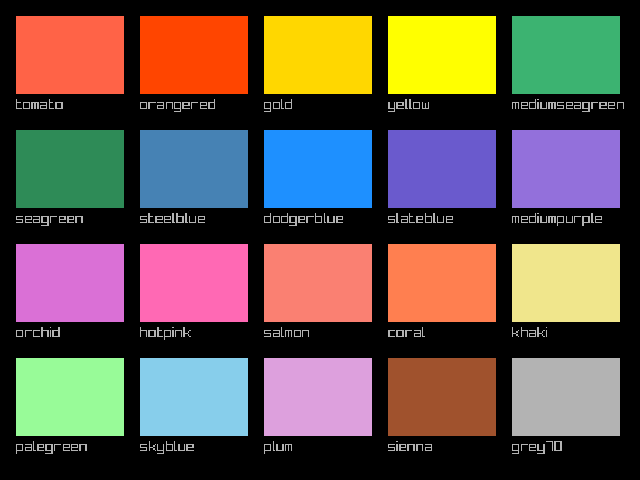
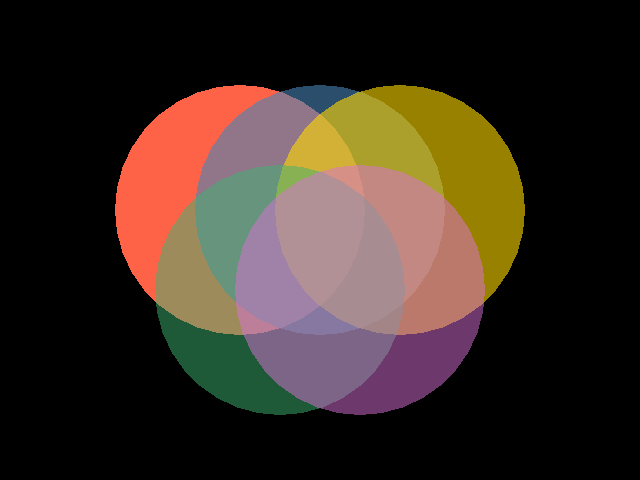
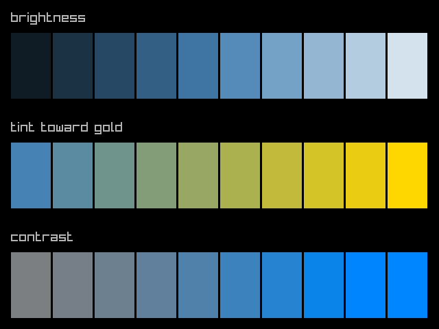
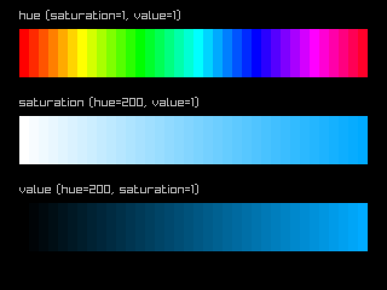
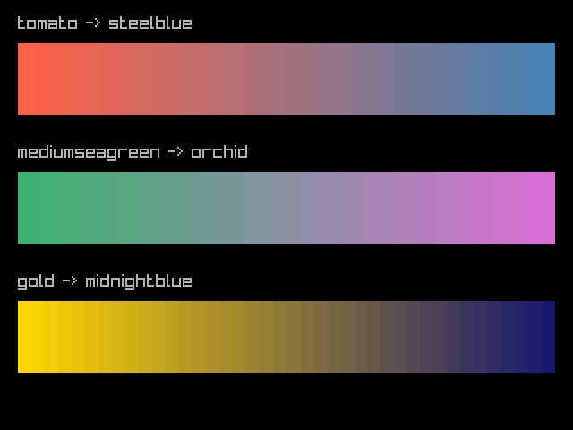

# Colors

One of raylibr’s nicest features is that R’s 657 built-in color names
work everywhere a color is expected. This guide covers the full color
system.

## R color names

Any function that takes a color argument accepts an R color name as a
string:

``` r

colors <- c(
  "tomato", "orangered", "gold", "yellow",
  "mediumseagreen", "seagreen", "steelblue", "dodgerblue",
  "slateblue", "mediumpurple", "orchid", "hotpink",
  "salmon", "coral", "khaki", "palegreen",
  "skyblue", "plum", "sienna", "grey70"
)
cols <- 5L
w <- 108L
h <- 78L
pad <- 16L
for (i in seq_along(colors)) {
  row <- (i - 1L) %/% cols
  col <- (i - 1L) %% cols
  x <- pad + col * (w + pad)
  y <- pad + row * (h + pad + 20L)
  draw_rectangle(as.integer(x), as.integer(y), w, h, colors[i])
  draw_text(colors[i], as.integer(x), as.integer(y + h + 3L), 15L, "grey70")
}
```



This includes all of
[`colors()`](https://rdrr.io/r/grDevices/colors.html) from base R —
`"red"`, `"steelblue"`, `"grey90"`, `"antiquewhite"`, and 653 more.

## The color struct

For precise control, construct colors with RGBA values (0–255):

``` r

col <- color(255, 100, 50, 255)
col$r
#> [1] 255
col$a
#> [1] 255
```

Convert from other representations with
[`as_color()`](https://jeroenjanssens.github.io/raylibr/reference/as_color.md):

``` r

as_color("tomato")
#> color(r = 255, g = 99, b = 71, a = 255)
as_color(0xFF6347FF)
#> color(r = 255, g = 99, b = 71, a = 255)
```

## Transparency

[`color_alpha()`](https://jeroenjanssens.github.io/raylibr/reference/color_alpha.md)
creates a transparent version of any color. The alpha ranges from 0
(invisible) to 1 (opaque):

``` r

draw_circle(240L, 210L, 125.0, "tomato")
draw_circle(320L, 210L, 125.0, color_alpha("steelblue", 0.6))
draw_circle(400L, 210L, 125.0, color_alpha("gold", 0.6))
draw_circle(280L, 290L, 125.0, color_alpha("mediumseagreen", 0.5))
draw_circle(360L, 290L, 125.0, color_alpha("orchid", 0.5))
```



[`fade()`](https://jeroenjanssens.github.io/raylibr/reference/fade.md)
does the same thing as
[`color_alpha()`](https://jeroenjanssens.github.io/raylibr/reference/color_alpha.md)
— both set the alpha channel.

## Color manipulation

raylibr provides functions to adjust colors:

``` r

base <- "steelblue"
w <- 58L
h <- 96L

# Brightness: -255 to 255
draw_text("brightness", 16L, 16L, 20L, "grey70")
for (i in 0:9) {
  b <- -200 + i * 44
  draw_rectangle(16L + as.integer(i) * (w + 3L), 48L, w, h,
                 color_brightness(base, b / 255))
}

# Tint
draw_text("tint toward gold", 16L, 176L, 20L, "grey70")
for (i in 0:9) {
  frac <- i / 9
  draw_rectangle(16L + as.integer(i) * (w + 3L), 208L, w, h,
                 color_lerp(base, "gold", frac))
}

# Contrast: -255 to 255
draw_text("contrast", 16L, 336L, 20L, "grey70")
for (i in 0:9) {
  c_val <- -200 + i * 44
  draw_rectangle(16L + as.integer(i) * (w + 3L), 368L, w, h,
                 color_contrast(base, c_val / 255))
}
```



- `color_brightness(color, factor)` — lighten (positive) or darken
  (negative)
- `color_contrast(color, factor)` — increase or decrease contrast
- `color_tint(color, tint)` — tint a color toward another

## HSV color space

[`color_from_hsv()`](https://jeroenjanssens.github.io/raylibr/reference/color_from_hsv.md)
creates colors from hue (0–360), saturation (0–1), and value (0–1). This
is great for generating color ramps:

``` r

n <- 36L
w <- 16L
# Hue rainbow
draw_text("hue (saturation=1, value=1)", 32L, 16L, 20L, "grey70")
for (i in 0:(n - 1L)) {
  draw_rectangle(32L + as.integer(i) * w, 48L, w, 80L,
                 color_from_hsv(i * 360.0 / n, 1.0, 1.0))
}
# Saturation ramp
draw_text("saturation (hue=200, value=1)", 32L, 160L, 20L, "grey70")
for (i in 0:(n - 1L)) {
  draw_rectangle(32L + as.integer(i) * w, 192L, w, 80L,
                 color_from_hsv(200.0, i / (n - 1.0), 1.0))
}
# Value ramp
draw_text("value (hue=200, saturation=1)", 32L, 304L, 20L, "grey70")
for (i in 0:(n - 1L)) {
  draw_rectangle(32L + as.integer(i) * w, 336L, w, 80L,
                 color_from_hsv(200.0, 1.0, i / (n - 1.0)))
}
```



Convert back with
[`color_to_hsv()`](https://jeroenjanssens.github.io/raylibr/reference/color_to_hsv.md):

``` r

color_to_hsv("tomato")
#>         x         y         z 
#> 9.1304340 0.7215686 1.0000000
```

## Interpolation

[`color_lerp()`](https://jeroenjanssens.github.io/raylibr/reference/color_lerp.md)
blends between two colors. Use it to create smooth gradients:

``` r

n <- 40L
w <- 15L

from <- "tomato"
to <- "steelblue"
draw_text("tomato -> steelblue", 20L, 16L, 20L, "grey70")
for (i in 0:(n - 1L)) {
  draw_rectangle(20L + as.integer(i) * w, 48L, w, 80L,
                 color_lerp(from, to, i / (n - 1.0)))
}

from2 <- "mediumseagreen"
to2 <- "orchid"
draw_text("mediumseagreen -> orchid", 20L, 160L, 20L, "grey70")
for (i in 0:(n - 1L)) {
  draw_rectangle(20L + as.integer(i) * w, 192L, w, 80L,
                 color_lerp(from2, to2, i / (n - 1.0)))
}

from3 <- "gold"
to3 <- "midnightblue"
draw_text("gold -> midnightblue", 20L, 304L, 20L, "grey70")
for (i in 0:(n - 1L)) {
  draw_rectangle(20L + as.integer(i) * w, 336L, w, 80L,
                 color_lerp(from3, to3, i / (n - 1.0)))
}
```



[`color_alpha_blend()`](https://jeroenjanssens.github.io/raylibr/reference/color_alpha_blend.md)
blends a foreground color over a background, respecting the foreground’s
alpha channel — useful for compositing.
