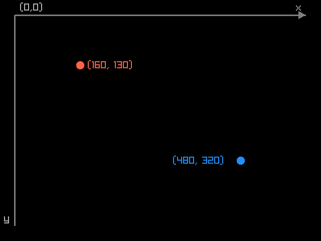
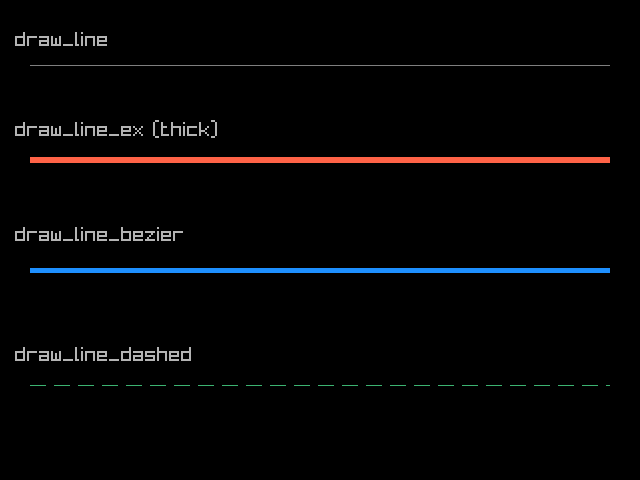
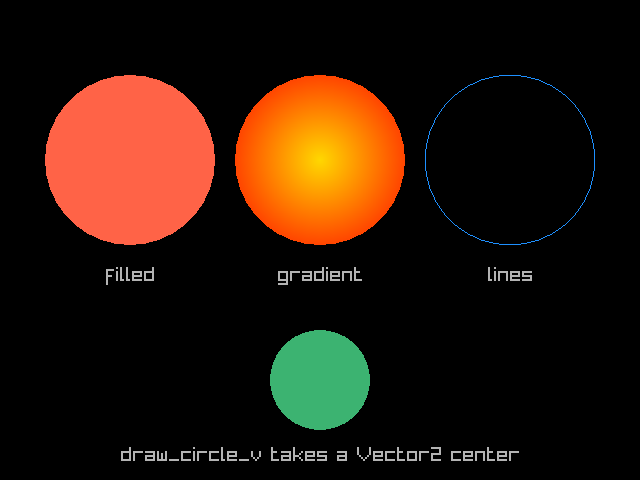
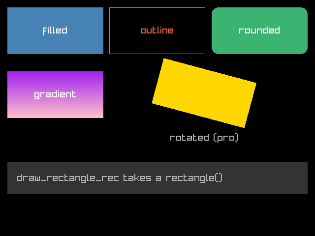
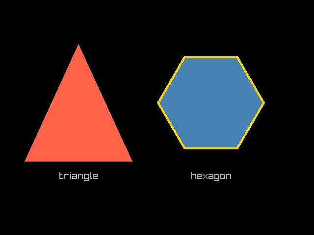
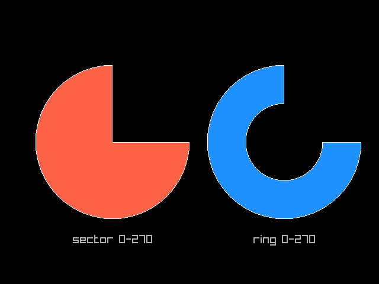
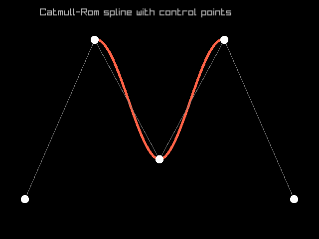
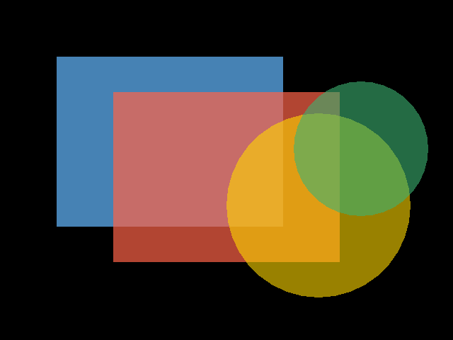

# Drawing 2D Shapes

This guide covers all 2D shape-drawing functions available in raylibr.
Each snippet shows only the drawing code; it runs inside
[`raylibr_screenshot()`](https://jeroenjanssens.github.io/raylibr/reference/raylibr_screenshot.md)
which creates a hidden 640x480 window with a black background.

## Coordinate system

The origin `(0, 0)` is at the **top-left** corner. X increases to the
right, Y increases downward.

``` r

# Axes
draw_line_ex(c(30, 30), c(610, 30), 3.0, "grey50")
draw_line_ex(c(30, 30), c(30, 450), 3.0, "grey50")
draw_text("x", 590L, 5L, 20L, "grey70")
draw_text("y", 8L, 425L, 20L, "grey70")
draw_text("(0,0)", 40L, 5L, 20L, "grey70")
# Arrowheads
draw_triangle(c(610, 30), c(595, 22), c(595, 38), "grey50")
draw_triangle(c(30, 450), c(22, 435), c(38, 435), "grey50")
# Sample points
draw_circle(160L, 130L, 8.0, "tomato")
draw_text("(160, 130)", 175L, 120L, 20L, "tomato")
draw_circle(480L, 320L, 8.0, "dodgerblue")
draw_text("(480, 320)", 345L, 310L, 20L, "dodgerblue")
```



## Lines

``` r

draw_line(30L, 65L, 610L, 65L, "grey50")
draw_text("draw_line", 15L, 30L, 20L, "grey70")

draw_line_ex(c(30, 160), c(610, 160), 6.0, "tomato")
draw_text("draw_line_ex (thick)", 15L, 120L, 20L, "grey70")

draw_line_bezier(c(30, 270), c(610, 270), 5.0, "dodgerblue")
draw_text("draw_line_bezier", 15L, 225L, 20L, "grey70")

draw_line_dashed(c(30, 385), c(610, 385), 16.0, 8.0, "mediumseagreen")
draw_text("draw_line_dashed", 15L, 345L, 20L, "grey70")
```



[`draw_line_ex()`](https://jeroenjanssens.github.io/raylibr/reference/draw_line_ex.md)
and
[`draw_line_bezier()`](https://jeroenjanssens.github.io/raylibr/reference/draw_line_bezier.md)
take `Vector2` endpoints (two-element numeric vectors) and a thickness
argument.

## Circles

``` r

draw_circle(130L, 160L, 85.0, "tomato")
draw_text("filled", 106L, 265L, 20L, "grey70")

draw_circle_gradient(c(320, 160), 85.0, "gold", "orangered")
draw_text("gradient", 278L, 265L, 20L, "grey70")

draw_circle_lines(510L, 160L, 85.0, "dodgerblue")
draw_text("lines", 488L, 265L, 20L, "grey70")

draw_circle_v(c(320, 380), 50.0, "mediumseagreen")
draw_text("draw_circle_v takes a Vector2 center", 121L, 445L, 20L, "grey70")
```



[`draw_circle()`](https://jeroenjanssens.github.io/raylibr/reference/draw_circle.md)
takes integer center coordinates, while
[`draw_circle_v()`](https://jeroenjanssens.github.io/raylibr/reference/draw_circle_v.md)
takes a `c(x, y)` vector.

## Rectangles

``` r

draw_rectangle(15L, 15L, 195L, 95L, "steelblue")
draw_text("filled", 88L, 52L, 20L, "white")

draw_rectangle_lines(222L, 15L, 195L, 95L, "tomato")
draw_text("outline", 286L, 52L, 20L, "tomato")

draw_rectangle_rounded(rectangle(430, 15, 195, 95), 0.3, 10L, "mediumseagreen")
draw_text("rounded", 486L, 52L, 20L, "white")

draw_rectangle_gradient_v(15L, 145L, 195L, 95L, "purple", "pink")
draw_text("gradient", 70L, 182L, 20L, "white")

draw_rectangle_pro(
  rectangle(415, 190, 195, 95),
  c(98, 48), 15.0, "gold"
)
draw_text("rotated (pro)", 346L, 270L, 20L, "grey70")

draw_rectangle_rec(rectangle(15, 330, 610, 65), "grey20")
draw_text("draw_rectangle_rec takes a rectangle()", 35L, 352L, 20L, "grey70")
```



[`draw_rectangle_pro()`](https://jeroenjanssens.github.io/raylibr/reference/draw_rectangle_pro.md)
supports rotation around an origin point.
[`draw_rectangle_rec()`](https://jeroenjanssens.github.io/raylibr/reference/draw_rectangle_rec.md)
and
[`draw_rectangle_rounded()`](https://jeroenjanssens.github.io/raylibr/reference/draw_rectangle_rounded.md)
take a
[`rectangle()`](https://jeroenjanssens.github.io/raylibr/reference/rectangle.md)
struct.

## Triangles and polygons

``` r

draw_triangle(
  c(160, 90), c(50, 330), c(270, 330),
  "tomato"
)
draw_text("triangle", 121L, 350L, 20L, "grey70")

draw_poly(c(430, 210), 6L, 110.0, 0.0, "steelblue")
draw_text("hexagon", 389L, 350L, 20L, "grey70")

draw_poly_lines_ex(c(430, 210), 6L, 110.0, 0.0, 5.0, "gold")
```



[`draw_poly()`](https://jeroenjanssens.github.io/raylibr/reference/draw_poly.md)
draws a regular polygon: center, number of sides, radius, rotation,
color.
[`draw_poly_lines_ex()`](https://jeroenjanssens.github.io/raylibr/reference/draw_poly_lines_ex.md)
draws its outline with a given thickness.

Note:
[`draw_triangle()`](https://jeroenjanssens.github.io/raylibr/reference/draw_triangle.md)
vertices must be in **counter-clockwise** order, or the triangle won’t
render.

## Arcs and rings

``` r

draw_circle_sector(c(190, 240), 130.0, 0.0, 270.0, 36L, "tomato")
draw_circle_sector_lines(c(190, 240), 130.0, 0.0, 270.0, 36L, "white")
draw_text("sector 0-270", 123L, 395L, 20L, "grey70")

draw_ring(c(480, 240), 65.0, 130.0, 0.0, 270.0, 36L, "dodgerblue")
draw_ring_lines(c(480, 240), 65.0, 130.0, 0.0, 270.0, 36L, "white")
draw_text("ring 0-270", 428L, 395L, 20L, "grey70")
```



Angles are in degrees. `0` points right, and the arc sweeps
**counter-clockwise**. The `segments` parameter controls smoothness
(more segments = smoother curves).

## Splines

Spline functions take a matrix of control points (one row per point, two
columns for x and y):

``` r

pts <- matrix(c(
  50, 400,
  190, 80,
  320, 320,
  450, 80,
  590, 400
), ncol = 2, byrow = TRUE)

draw_spline_catmull_rom(pts, 5.0, "tomato")
draw_spline_linear(pts, 1.0, "grey50")
# Draw control points
for (i in seq_len(nrow(pts))) {
  draw_circle(as.integer(pts[i, 1]), as.integer(pts[i, 2]), 8.0, "white")
}
draw_text("Catmull-Rom spline with control points", 80L, 15L, 20L, "grey70")
```



Other spline types include
[`draw_spline_bezier_cubic()`](https://jeroenjanssens.github.io/raylibr/reference/draw_spline_bezier_cubic.md),
[`draw_spline_bezier_quadratic()`](https://jeroenjanssens.github.io/raylibr/reference/draw_spline_bezier_quadratic.md),
and
[`draw_spline_basis()`](https://jeroenjanssens.github.io/raylibr/reference/draw_spline_basis.md).

## Layering

Shapes are drawn in order using the painter’s algorithm: later calls
draw on top of earlier ones. Combine this with
[`color_alpha()`](https://jeroenjanssens.github.io/raylibr/reference/color_alpha.md)
for transparency effects:

``` r

draw_rectangle(80L, 80L, 320L, 240L, "steelblue")
draw_rectangle(160L, 130L, 320L, 240L, color_alpha("tomato", 0.7))
draw_circle(450L, 290L, 130.0, color_alpha("gold", 0.6))
draw_circle(510L, 210L, 95.0, color_alpha("mediumseagreen", 0.6))
```



See the
[Colors](https://jeroenjanssens.github.io/raylibr/articles/guide-colors.md)
guide for more on transparency and color manipulation.
