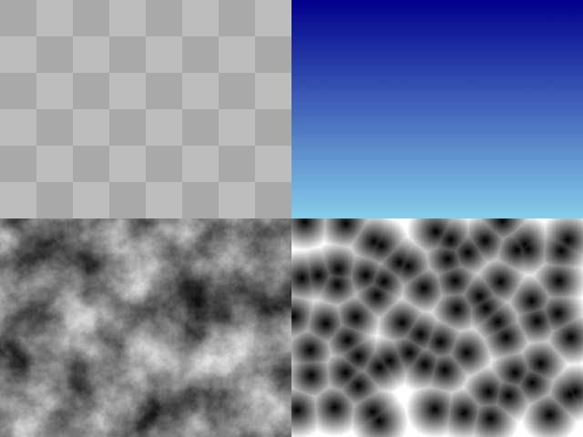
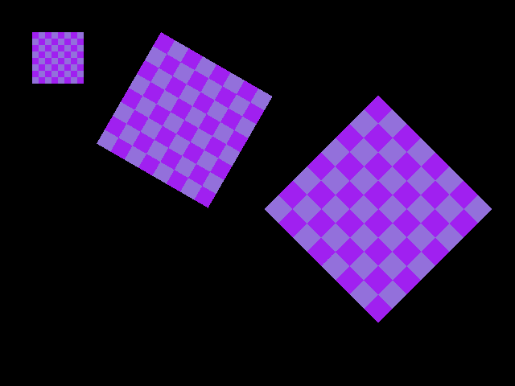

# Images & Textures

Raylib distinguishes between **images** (pixel data in CPU memory) and
**textures** (pixel data uploaded to the GPU). Images can be manipulated
freely. Textures can be drawn to the screen.

The typical pipeline is: load or generate an image, optionally
manipulate it, upload it as a texture, draw the texture.

## Generating images

raylibr can generate several kinds of procedural images:

``` r

imgs <- list(
  gen_image_checked(320L, 240L, 40L, 40L, "darkgray", "gray"),
  gen_image_gradient_linear(320L, 240L, 0L, "darkblue", "skyblue"),
  gen_image_perlin_noise(320L, 240L, 0L, 0L, 4.0),
  gen_image_cellular(320L, 240L, 32L)
)
positions <- list(c(0L, 0L), c(320L, 0L), c(0L, 240L), c(320L, 240L))
for (i in seq_along(imgs)) {
  tex <- load_texture_from_image(imgs[[i]])
  unload_image(imgs[[i]])
  draw_texture(tex, positions[[i]][1], positions[[i]][2], "white")
}
```



Top-left: checkerboard (`gen_image_checked`). Top-right: linear gradient
(`gen_image_gradient_linear`). Bottom-left: Perlin noise
(`gen_image_perlin_noise`). Bottom-right: cellular/Voronoi
(`gen_image_cellular`).

Other generators include
[`gen_image_color()`](https://jeroenjanssens.github.io/raylibr/reference/gen_image_color.md),
[`gen_image_gradient_radial()`](https://jeroenjanssens.github.io/raylibr/reference/gen_image_gradient_radial.md),
[`gen_image_gradient_square()`](https://jeroenjanssens.github.io/raylibr/reference/gen_image_gradient_square.md),
and
[`gen_image_white_noise()`](https://jeroenjanssens.github.io/raylibr/reference/gen_image_white_noise.md).

## Loading images

Load an image from a file with
[`load_image()`](https://jeroenjanssens.github.io/raylibr/reference/load_image.md):

``` r

img <- load_image("photo.png")
# Supported formats: PNG, BMP, TGA, JPG, GIF, PSD, HDR, PIC, PNM, KTX, ASTC, DDS, PKM
```

Check validity with `is_image_valid(img)` and free memory with
`unload_image(img)`.

## Image manipulation

Images live in CPU memory, so you can modify them before uploading to
the GPU:

``` r

copy <- image_copy(img)
sub <- image_from_image(img, rectangle(0, 0, 100, 100))
channel <- image_from_channel(img, 0L)
```

You can also draw onto images with
[`image_draw_line_ex()`](https://jeroenjanssens.github.io/raylibr/reference/image_draw_line_ex.md)
and
[`image_draw_triangle()`](https://jeroenjanssens.github.io/raylibr/reference/image_draw_triangle.md).

## Drawing textures

Convert an image to a texture with
[`load_texture_from_image()`](https://jeroenjanssens.github.io/raylibr/reference/load_texture_from_image.md),
or load directly with
[`load_texture()`](https://jeroenjanssens.github.io/raylibr/reference/load_texture.md):

``` r

img <- gen_image_checked(64L, 64L, 8L, 8L, "purple", "mediumpurple")
tex <- load_texture_from_image(img)
unload_image(img)

draw_texture(tex, 40L, 40L, "white")
draw_texture_ex(tex, c(200, 40), 30.0, 2.5, "white")
draw_texture_pro(
  tex,
  rectangle(0, 0, 64, 64),
  rectangle(470, 260, 200, 200),
  c(100, 100), 45.0, "white"
)
```



- [`draw_texture()`](https://jeroenjanssens.github.io/raylibr/reference/draw_texture.md)
  draws at a position with a tint color
- [`draw_texture_ex()`](https://jeroenjanssens.github.io/raylibr/reference/draw_texture_ex.md)
  adds rotation and scale
- [`draw_texture_pro()`](https://jeroenjanssens.github.io/raylibr/reference/draw_texture_pro.md)
  gives full control: source rectangle, destination rectangle, origin,
  and rotation

The image can be unloaded as soon as it has been uploaded as a texture.
The texture itself must stay loaded until the frame has been drawn:
Raylib collects draw calls in a batch and only sends them to the GPU at
[`end_drawing()`](https://jeroenjanssens.github.io/raylibr/reference/end_drawing.md),
so a texture unloaded before then is drawn as nothing. In a game loop,
load textures before the loop and call
[`unload_texture()`](https://jeroenjanssens.github.io/raylibr/reference/unload_texture.md)
after it. In these snippets the screenshot window is closed right after
the frame, which releases the textures with it.

## Render textures

A render texture lets you draw to an off-screen buffer, then use the
result as a regular texture. This is the basis for post-processing
effects:

``` r

target <- load_render_texture(800L, 600L)

begin_texture_mode(target)
  clear_background("black")
  draw_circle(400L, 300L, 100.0, "red")
end_texture_mode()

begin_drawing()
  draw_texture_rec(
    target$texture,
    rectangle(0, 0, 800, -600),
    c(0, 0), "white"
  )
end_drawing()

unload_render_texture(target)
```

Note the negative height in the source rectangle – render textures are
flipped vertically in OpenGL.

## Exporting images

Save an image to disk:

``` r

img <- load_image_from_screen()
export_image(img, "screenshot.png")
```

Supported export formats: PNG, BMP, TGA, JPG, KTX, RAW.
