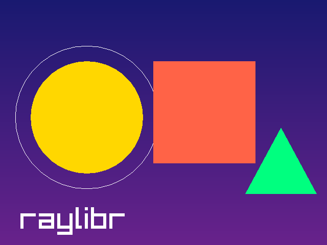
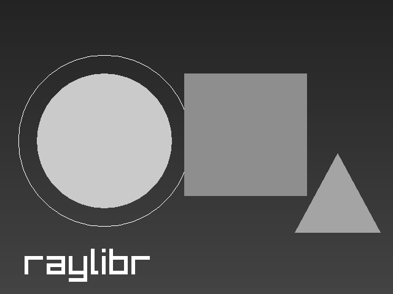
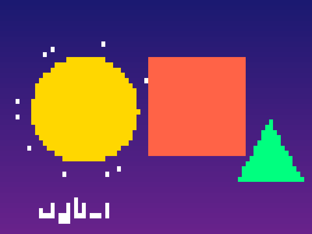
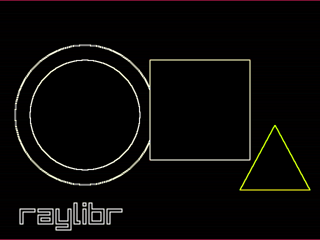
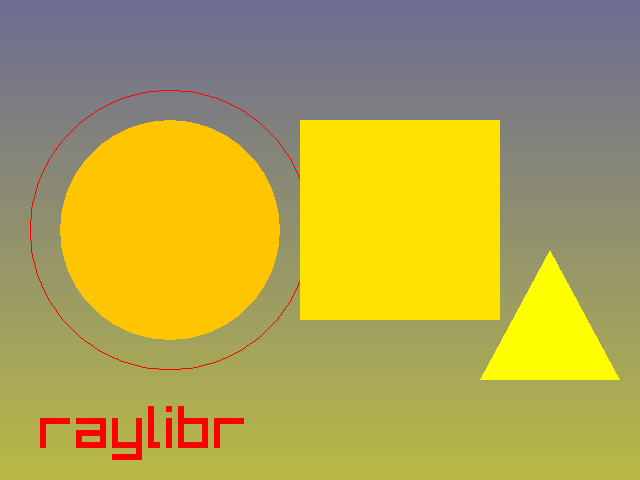
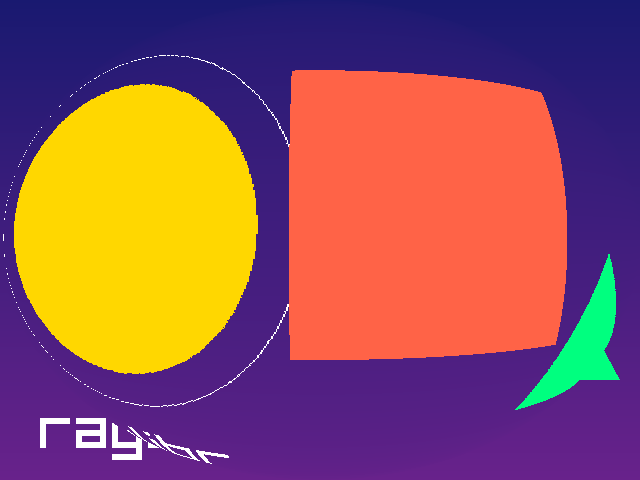
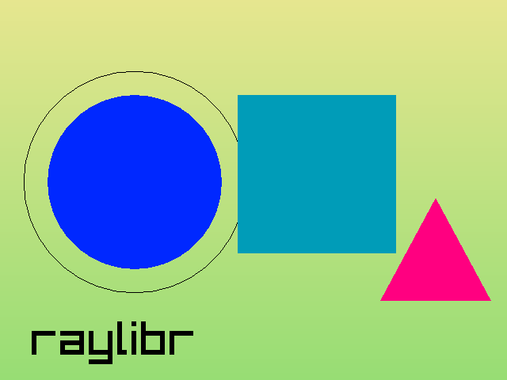

# Shaders

Shaders are small programs that run on the GPU and control how things
are drawn. A **vertex shader** determines where vertices appear on
screen, and a **fragment shader** determines the color of each pixel.
raylibr lets you load custom GLSL shaders to create visual effects.

## Loading shaders

Load shaders from files or from strings in memory:

``` r

# From files
shader <- load_shader("vertex.glsl", "fragment.glsl")

# Pass "" for either to use Raylib's default
shader <- load_shader("", "my_effect.glsl")

# From strings
fs_code <- "
#version 330
in vec2 fragTexCoord;
in vec4 fragColor;
out vec4 finalColor;
uniform sampler2D texture0;
void main() {
    vec4 color = texture(texture0, fragTexCoord) * fragColor;
    float gray = dot(color.rgb, vec3(0.299, 0.587, 0.114));
    finalColor = vec4(gray, gray, gray, color.a);
}
"
shader <- load_shader_from_memory("", fs_code)
```

## Using shaders

Wrap your drawing calls in
[`begin_shader_mode()`](https://jeroenjanssens.github.io/raylibr/reference/begin_shader_mode.md)
/
[`end_shader_mode()`](https://jeroenjanssens.github.io/raylibr/reference/end_shader_mode.md):

``` r

begin_shader_mode(shader)
draw_texture(my_texture, 0L, 0L, "white")
end_shader_mode()
```

Everything drawn between these calls uses the custom shader instead of
the default rendering.

## Uniforms

Pass data from R to the shader via **uniforms** — named variables in the
GLSL code:

``` r

loc <- get_shader_location(shader, "intensity")
set_shader_value(shader, loc, 0.5)           # float
set_shader_value(shader, loc, c(1.0, 0.5))   # vec2
set_shader_value(shader, loc, c(1, 0, 0))    # vec3
set_shader_value(shader, loc, c(1, 0, 0, 1)) # vec4
```

[`set_shader_value()`](https://jeroenjanssens.github.io/raylibr/reference/set_shader_value.md)
automatically picks the right GLSL type based on the length of the R
vector.

For matrices, use
[`set_shader_value_matrix()`](https://jeroenjanssens.github.io/raylibr/reference/set_shader_value_matrix.md).
For textures, use
[`set_shader_value_texture()`](https://jeroenjanssens.github.io/raylibr/reference/set_shader_value_texture.md).

## Post-processing pattern

The most common shader use case is post-processing: render the scene
normally to an off-screen texture, then draw that texture to the screen
through a shader.

``` r

# Setup
target <- load_render_texture(640L, 480L)
shader <- load_shader("", "my_effect.glsl")
source_rec <- rectangle(0, 0, 640, -480)  # flipped Y for render texture

# In the game loop:
begin_texture_mode(target)
  clear_background("black")
  # ... draw your scene normally ...
end_texture_mode()

begin_drawing()
  begin_shader_mode(shader)
  draw_texture_rec(target$texture, source_rec, c(0, 0), "white")
  end_shader_mode()
end_drawing()
```

Note the negative height in the source rectangle — render textures are
vertically flipped in OpenGL.

## Examples

The examples below all post-process the same scene. Two small helpers
keep the snippets short: `draw_scene()` draws the scene, and
`post_process()` follows the pattern above, rendering the scene to a
texture and drawing that texture through a shader.

``` r

draw_scene <- function() {
  draw_rectangle_gradient_v(0L, 0L, 640L, 480L, "midnightblue", "darkorchid4")
  draw_circle(170L, 230L, 110.0, "gold")
  draw_circle_lines(170L, 230L, 140.0, "white")
  draw_rectangle(300L, 120L, 200L, 200L, "tomato")
  draw_triangle(c(480, 380), c(620, 380), c(550, 250), "springgreen")
  draw_text("raylibr", 40L, 400L, 60L, "white")
}

post_process <- function(shader) {
  target <- load_render_texture(640L, 480L)
  begin_texture_mode(target)
  draw_scene()
  end_texture_mode()

  begin_shader_mode(shader)
  draw_texture_rec(target$texture, rectangle(0, 0, 640, -480), c(0, 0), "white")
  end_shader_mode()
}
```

Without a shader, the scene looks like this:

``` r

draw_scene()
```



raylibr ships with a collection of post-processing shaders from the
Raylib examples, which you can find with
[`raylibr_resource()`](https://jeroenjanssens.github.io/raylibr/reference/raylibr_resource.md).

### Grayscale

Converts each pixel to its luminance, using the weights
`(0.299, 0.587, 0.114)` to match human perception:

``` r

shader <- load_shader("", raylibr_resource("model/grayscale.fs"))
post_process(shader)
```



### Pixelation

The pixelizer shader has uniforms for the block size, which you can set
from R:

``` r

shader <- load_shader("", raylibr_resource("model/pixelizer.fs"))
set_shader_value(shader, get_shader_location(shader, "pixelWidth"), 10)
set_shader_value(shader, get_shader_location(shader, "pixelHeight"), 10)
post_process(shader)
```



### Edge detection

The Sobel operator compares neighbouring pixels to find edges:

``` r

shader <- load_shader("", raylibr_resource("model/sobel.fs"))
post_process(shader)
```



### Thermal vision

Maps the brightness of each pixel onto a heat-camera palette:

``` r

shader <- load_shader("", raylibr_resource("model/predator.fs"))
post_process(shader)
```



### Fisheye

A fragment shader can also move pixels around. This one samples the
texture through a lens distortion:

``` r

shader <- load_shader("", raylibr_resource("model/fisheye.fs"))
post_process(shader)
```



### Writing your own

A fragment shader of your own can be loaded from a string. This one
inverts every color:

``` r

fs_code <- "
#version 330
in vec2 fragTexCoord;
in vec4 fragColor;
out vec4 finalColor;
uniform sampler2D texture0;
void main() {
    vec4 color = texture(texture0, fragTexCoord) * fragColor;
    finalColor = vec4(1.0 - color.rgb, color.a);
}
"
shader <- load_shader_from_memory("", fs_code)
post_process(shader)
```



In a real program, load shaders once before the game loop and free them
with
[`unload_shader()`](https://jeroenjanssens.github.io/raylibr/reference/unload_shader.md)
afterwards.

## Further reading

See these demos for more advanced shader usage:

- [Shader
  Stars](https://jeroenjanssens.github.io/raylibr/articles/demo-shader.md)
  — animated GLSL fragment shader with uniform updates each frame
- [Julia
  Sets](https://jeroenjanssens.github.io/raylibr/articles/demo-julia.md)
  — fractal rendering with mouse-driven zoom via shader uniforms
