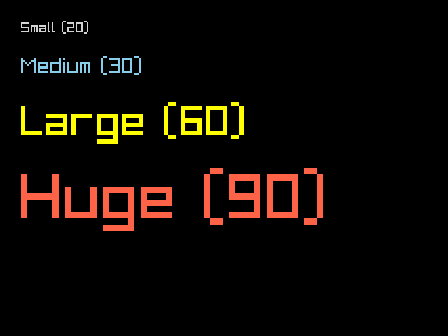
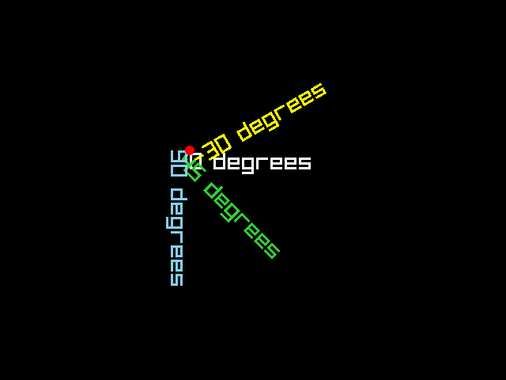
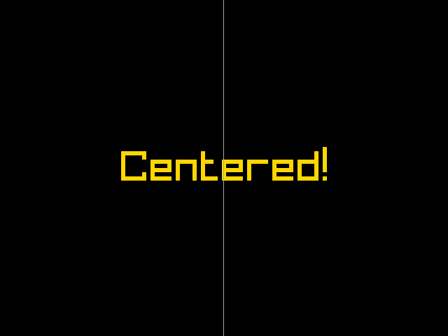

# Text & Fonts

raylibr provides several functions for drawing text, from simple
one-liners to fully controlled rendering with custom fonts, rotation,
and spacing.

## Simple text

[`draw_text()`](https://jeroenjanssens.github.io/raylibr/reference/draw_text.md)
is the quickest way to put text on screen. Pass the string, position,
font size (integer), and color.

``` r

draw_text("Small (20)", 30L, 30L, 20L, "lightgray")
draw_text("Medium (30)", 30L, 80L, 30L, "skyblue")
draw_text("Large (60)", 30L, 145L, 60L, "yellow")
draw_text("Huge (90)", 30L, 240L, 90L, "tomato")
```



The default font is a built-in bitmap font included with Raylib.

## Custom fonts

For higher quality text, load a TTF or OTF font with
[`load_font_ex()`](https://jeroenjanssens.github.io/raylibr/reference/load_font_ex.md):

``` r

font <- load_font_ex("path/to/font.ttf", 32L)
draw_text_ex(font, "Custom font!", c(100, 100), 32.0, 2.0, "white")
unload_font(font)
```

[`draw_text_ex()`](https://jeroenjanssens.github.io/raylibr/reference/draw_text_ex.md)
takes a font object, text, position (Vector2), font size (float),
character spacing, and color.

## Rotated text

[`draw_text_pro()`](https://jeroenjanssens.github.io/raylibr/reference/draw_text_pro.md)
adds rotation and an origin point. The origin is relative to the
top-left of the text and determines the pivot for rotation.

``` r

font <- get_font_default()
draw_text_pro(font, "0 degrees", c(240, 190), c(0, 0), 0.0, 30.0, 3.0, as_color("white"))
draw_text_pro(font, "45 degrees", c(240, 190), c(0, 0), 45.0, 30.0, 3.0, as_color("limegreen"))
draw_text_pro(font, "90 degrees", c(240, 190), c(0, 0), 90.0, 30.0, 3.0, as_color("skyblue"))
draw_text_pro(font, "-30 degrees", c(240, 190), c(0, 0), -30.0, 30.0, 3.0, as_color("yellow"))
draw_circle(240L, 190L, 6.0, "red")
```



The red dot marks the shared origin point. Each string fans out from
there at a different angle.

## Measuring text

[`measure_text()`](https://jeroenjanssens.github.io/raylibr/reference/measure_text.md)
returns the width of a string in pixels at a given font size. Use it to
center text:

``` r

text <- "Centered!"
size <- 60L
w <- measure_text(text, size)
x <- (640L - w) %/% 2L
draw_text(text, x, 210L, size, "gold")
draw_line(320L, 0L, 320L, 480L, "darkgray")
```



For custom fonts, use `measure_text_ex(font, text, font_size, spacing)`
which returns a Vector2 with both width and height.

## Line spacing

[`set_text_line_spacing()`](https://jeroenjanssens.github.io/raylibr/reference/set_text_line_spacing.md)
controls the vertical distance between lines when drawing multi-line
strings (strings containing `\n`):

``` r

set_text_line_spacing(24L)
draw_text("Line one\nLine two\nLine three", 20L, 20L, 20L, "white")
```

## Text utilities

raylibr includes string manipulation functions:

``` r

text_to_upper("hello")       # "HELLO"
text_to_lower("HELLO")       # "hello"
text_to_snake("HelloWorld")  # "hello_world"
text_to_pascal("hello_world") # "HelloWorld"
text_to_camel("hello_world") # "helloWorld"
text_subtext("Hello", 0L, 3L) # "Hel"
text_length("Hello")          # 5
```
